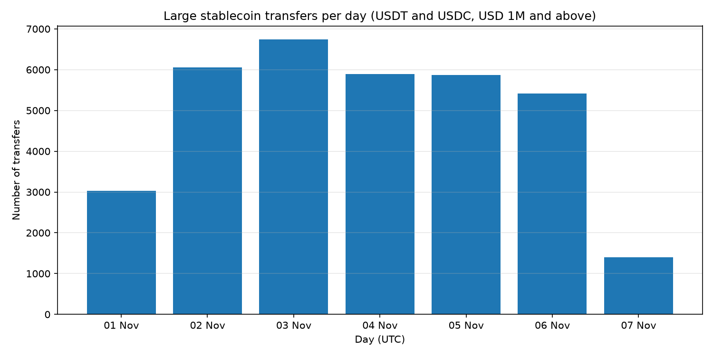
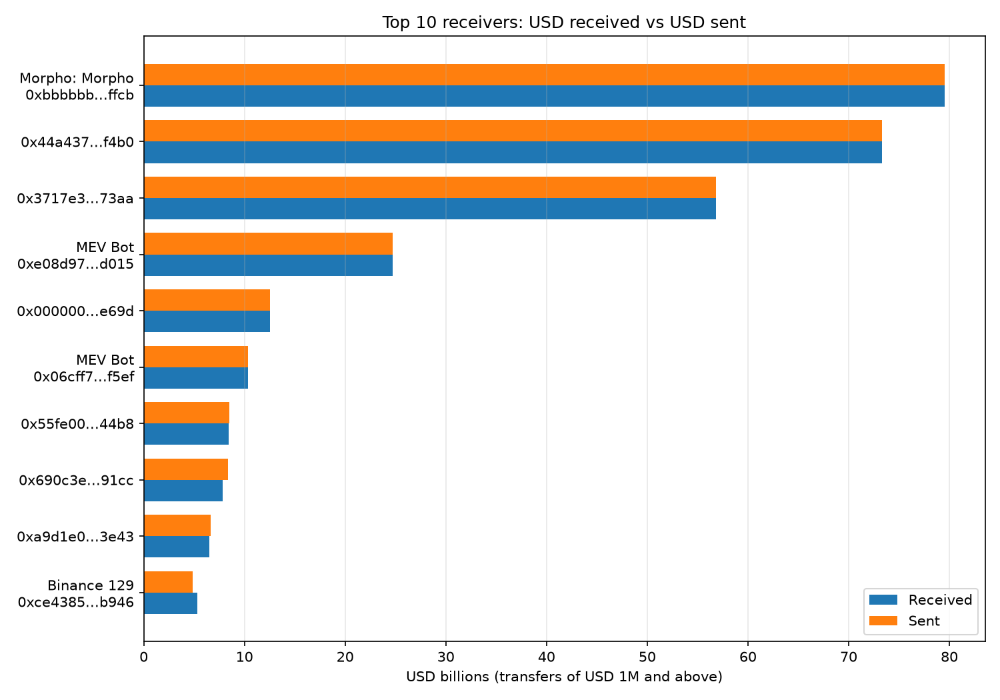

# Stablecoin Large-Transfer Monitor


On-chain monitoring of large USDT and USDC transfers (USD 1M and above) on Ethereum, built with SQL on Google BigQuery public blockchain data and a Python reporting layer.

Large stablecoin movements are one of the first signals that security, compliance and risk teams watch: exchange inflows, treasury moves, redemptions and the cash-out of stolen funds all appear as unusually large transfers. This project shows how to detect them, measure who sends and receives them, and test whether the headline volume reflects real movement or funds passing through intermediaries.

## Headline results (1 to 7 November 2026, UTC)

| Metric | Value |
|---|---|
| Large transfers (USD 1M and above) | 34,416 |
| Approximate volume | USD 444.8B |
| Average transfer size | USD 12.9M |
| Busiest day | 3 Nov: USD 125.3B (28.2% of the week) |
| Top 3 receivers (also the top 3 senders) | 47.1% of volume |
| Top 20 receivers / top 20 senders | 72.6% / 72.2% of volume |
| Volume at addresses that send about what they receive | USD 310.8B (69.9%) |
| Top 10 receivers with a public Etherscan tag | 4 of 10, holding 27.0% of volume |
| Net burn at the zero address | USD 1.5B |





### Key findings

1. **Activity was front-loaded.** 1 to 3 Nov carried 63.8% of the week volume. Daily volume fell from USD 125.3B on 3 Nov to USD 12.8B on 7 Nov.
2. **A few addresses dominate.** The same three addresses are the top three receivers and the top three senders, and together they account for 47.1% of volume on each side.
3. **The biggest addresses are protocol and automation addresses, not users.** Etherscan tags the largest address as Morpho (a lending protocol, 17.9% of volume), two more as MEV Bots (7.9% combined) and one as Binance 129 (1.2%). Five addresses holding 24.4% of volume have no tag, no creator and unverified code. These are the investigation queue.
4. **Much of the volume is pass-through.** Eight addresses sent exactly what they received, with identical transfer counts and totals (USD 188.7B each way, 42.4% of volume), and two of them are tagged MEV Bot. Across the 17 addresses that appear in both top-20 lists, USD 310.8B (69.9% of volume) is matched in-and-out. This is consistent with strategies that borrow and return funds within one transaction. Headline volume therefore overstates unique economic movement, because the same funds are counted at every hop.
5. **Repeated near-USD 100M transfers.** Several relay addresses, tagged and untagged, move amounts that average USD 99.0M to USD 99.6M per transfer. One received 574 transfers of exactly USD 99M. This points to automated or batched routing. It is a hypothesis to verify, not a conclusion.
6. **A few very large movers.** Three top-20 senders averaged between USD 183M and USD 434M per transfer across 5 to 25 transfers each. One of them was created by an address tagged Bitfinex 3, a lead that suggests exchange-related treasury or custody movements.
7. **Net redemption.** Large transfers to the zero address (USD 5.0B) exceeded large transfers from it (USD 3.5B) by USD 1.5B, which usually indicates more tokens burned than minted at this threshold.
8. **Weekend dip.** The two weekend days averaged 2,219 large transfers against 5,996 on weekdays (about 63% fewer). The sample is two days, so treat it as indicative.

The full analysis, tables and recommendations are in [REPORT.md](REPORT.md).

## Data and methodology

- **Source:** `bigquery-public-data.crypto_ethereum.token_transfers`
- **Tokens:** USDT (`0xdac17f958d2ee523a2206206994597c13d831ec7`) and USDC (`0xa0b86991c6218b36c1d19d4a2e9eb0ce3606eb48`), both 6 decimals
- **Window:** 2026-11-01 to 2026-11-07 inclusive (7 full days, UTC)
- **Threshold:** a transfer of USD 1,000,000 or more
- **Queries run:** [add the date you ran them]
- **USD value:** raw token value divided by 1,000,000, which treats each stablecoin as exactly USD 1
- **Shares:** measured against the total volume in `daily.csv`
- **Address labels:** Etherscan public name tags and contract-creator tags for the top 10 receivers and one additional sender, checked on 2026-11-11 and stored in `labels.csv`

## Repository structure

```
stablecoin-transfer-monitor/
|-- queries/
|   |-- 01_large_transfers.sql    Top 100 largest transfers in the window
|   |-- 02_daily_trend.sql        Daily count and volume of large transfers
|   |-- 03_top_receivers.sql      Top 20 receiving addresses by volume
|   |-- 04_top_senders.sql        Top 20 sending addresses by volume
|-- chart.py                      Builds daily_chart.png and flows_chart.png
|-- daily_chart.png               Daily transfers chart
|-- daily.csv                     Output of 02_daily_trend.sql
|-- flows_chart.png               Received vs sent chart
|-- labels.csv                    Etherscan tags and contract details, checked by hand on 2026-11-11
|-- README.md
|-- receivers.csv                 Output of 03_top_receivers.sql
|-- REPORT.md                     Full written analysis
|-- requirements.txt              Python dependencies
|-- senders.csv                   Output of 04_top_senders.sql
|-- stats.py                      Reproduces every headline number above
```

## How to reproduce

1. Run the four queries in `queries/` in the BigQuery console (sandbox mode is enough). Check the data-scanned estimate before each run.
2. Export the results of queries 02, 03 and 04 as `daily.csv`, `receivers.csv` and `senders.csv` into the project folder. `labels.csv` is compiled by hand from Etherscan and is included in the repository.
3. Set up Python:

```
python -m venv venv
venv\Scripts\activate
pip install -r requirements.txt
```

4. Build the charts and print the headline numbers:

```
python chart.py
python stats.py
```

On macOS or Linux, activate with `source venv/bin/activate`.

## Limitations

- **Approximate USD.** Both stablecoins are assumed to equal USD 1. Small de-pegs are not captured.
- **Double counting.** Volume counts every transfer, so funds passing through relay addresses or several contracts are counted at every hop. Finding 3 shows this is large in this window. Totals indicate activity, not net economic flow.
- **Two tokens only.** Other stablecoins and native ETH are not included.
- **Short window.** Seven days describes one week but cannot establish a baseline or detect rare outliers. Weekend findings rest on two days.
- **Labels are partial and manual.** BigQuery public data has none. Tags come from Etherscan, cover only the top 10 receivers and one sender, and were checked on 2026-11-11. Tags can change over time. A contract-creator tag is a lead, not an identification, and an untagged address is not necessarily unknown to others.
- **Top-20 view.** Two-way flow figures only cover addresses that appear in both top-20 lists, so they are a lower bound.
- **Data freshness.** An earlier export of 7 Nov returned fewer transfers (1,001) than a later re-export (1,405), which is consistent with the public dataset loading with a delay. Run queries for a day only after it has fully loaded, and re-check totals. Current totals reconcile with `senders.csv` within rounding.
- **Heuristics, not proof.** Repeated round amounts and balanced in-and-out flows are reasons to investigate further, not evidence of wrongdoing.

## Roadmap

- [x] v1.0: fixed window, four SQL queries, two charts, written report
- [x] v1.1: re-export `daily.csv`, reconcile totals and refresh the numbers
- [ ] v1.2: label the remaining top-20 addresses and re-check existing tags
- [ ] v2.0: accept a start and end date from the user (`python chart.py --start YYYY-MM-DD --end YYYY-MM-DD`)
- [ ] v2.1: remove pass-through double counting by grouping transfers by transaction hash
- [ ] v3.0: extend to 60 days, add alert rules and drill into outlier days

## Responsible use

This project uses public blockchain data for education and defensive analysis. It does not identify individuals or organizations. No address in this repository should be treated as belonging to any person or organization unless it carries a public label that is cited.

## Author

**Olupitan Joshua**, aspiring blockchain security analyst
[X](https://x.com/jarsh_cons) | [Gitub](https://github.com/JarsH-Con)