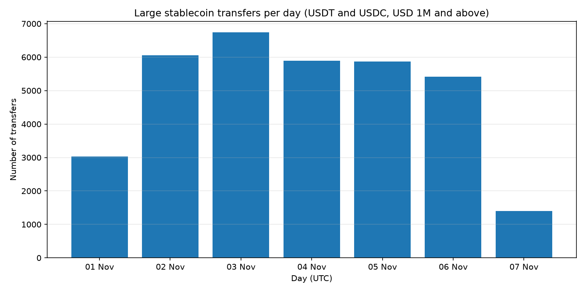
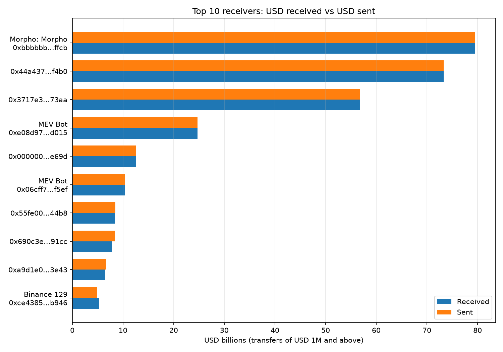

# Large Stablecoin Transfers on Ethereum: 1 to 7 November 2026

**Author:** [Olupitan Joshua]
**Date:** [12 NOV, 2026]
**Version:** 1.0
**Classification:** Public, educational analysis of public blockchain data

## 1. Executive summary

Between 1 and 7 November 2026, Ethereum recorded **34,416 USDT and USDC transfers of USD 1M or more**, worth about **USD 444.8B** in approximate terms. Activity was front-loaded: the first three days carried 63.8% of the volume, peaking at USD 125.3B on 3 November before falling to USD 12.8B on 7 November.

A small group of addresses handles most of this value. The same three addresses are the top three receivers and the top three senders, each side accounting for 47.1% of volume, and the top 20 on each side account for about 72%. More importantly, **the largest receivers are also the largest senders and send almost exactly what they receive.** Eight addresses show identical transfer counts and totals in both directions (USD 188.7B each way, 42.4% of volume), and across the 17 addresses present in both top-20 lists, USD 310.8B (69.9% of volume) is matched in-and-out. These addresses behave like relays or routers, so the headline figure counts the same funds repeatedly and overstates unique economic movement.

Etherscan labels, checked on 11 November 2026, show that the largest addresses are protocol and automation addresses rather than individual users. Among the top 10 receivers (64.2% of volume), the largest is tagged Morpho (a lending protocol, 17.9% of volume), two are tagged MEV Bot (7.9% combined) and one is tagged Binance 129 (1.2%). Five addresses holding 24.4% of volume carry no tag, no creator information and unverified code, and form the investigation queue.

Several relays, tagged and untagged, move transfers of almost identical size, close to USD 100M each, which suggests automated routing. Labels show what Etherscan publicly displays. They do not prove intent, and the patterns in this report remain hypotheses to be tested at transaction level.

## 2. Objective

To build a repeatable method for detecting and summarizing large stablecoin movements, the signal that exchange risk desks, protocol security teams and compliance analysts monitor for exchange inflows, treasury activity, redemptions and the movement of illicit funds, and to test how much of the headline volume reflects real movement.

## 3. Data and method

| Item | Detail |
|---|---|
| Source | `bigquery-public-data.crypto_ethereum.token_transfers` |
| Tokens | USDT and USDC (6 decimals each) |
| Window | 2026-11-01 to 2026-11-07 inclusive, 7 full days, UTC |
| Large transfer | USD 1,000,000 or more |
| USD conversion | Raw value divided by 1,000,000; each token is treated as USD 1 |
| Queries run | [add the date you ran them] |
| Tools | Google BigQuery (SQL), Python (pandas, matplotlib) |
| Shares | Measured against the total volume in `daily.csv` |
| Address labels | Etherscan name tags and contract-creator tags, checked 2026-11-11 (`labels.csv`) |

**Process**
1. `queries/01_large_transfers.sql` lists the 100 largest transfers.
2. `queries/02_daily_trend.sql` counts large transfers and sums their value per day.
3. `queries/03_top_receivers.sql` ranks receiving addresses by volume.
4. `queries/04_top_senders.sql` ranks sending addresses by volume.
5. Results were exported to `daily.csv`, `receivers.csv` and `senders.csv`, then charted with `chart.py` and summarized with `stats.py`.

All four queries use the same fixed dates, so every figure refers to the same period.

## 4. Results

### 4.1 Daily activity

| Date | Weekday | Large transfers | Volume (USD B) | Average size (USD M) |
|---|---|---|---|---|
| 2026-11-01 | Sunday | 3,033 | 73.81 | 24.3 |
| 2026-11-02 | Monday | 6,056 | 84.68 | 14.0 |
| 2026-11-03 | Tuesday | 6,737 | 125.28 | 18.6 |
| 2026-11-04 | Wednesday | 5,894 | 75.96 | 12.9 |
| 2026-11-05 | Thursday | 5,873 | 36.00 | 6.1 |
| 2026-11-06 | Friday | 5,418 | 36.23 | 6.7 |
| 2026-11-07 | Saturday | 1,405 | 12.80 | 9.1 |
| **Total** | | **34,416** | **444.77** | **12.9** |

**Observations**
- Volume peaked on 3 November (USD 125.3B, 28.2% of the window) and was about 10 times lower on 7 November.
- Transfer counts were steady on weekdays (about 5,400 to 6,700) while volume fell sharply from 5 November. Average transfer size dropped from USD 18.6M on 3 November to USD 6.1M on 5 November, so the decline came from smaller transfers, not fewer of them.
- The two weekend days averaged 2,219 large transfers against 5,996 on weekdays, about 63% fewer. With only two weekend days, this is indicative only.

### 4.2 Top receiving addresses

Full addresses are in `receivers.csv`.

| Rank | Address (shortened) | Transfers | Volume (USD B) | Share of volume | Average size (USD M) | Etherscan label |
|---|---|---|---|---|---|---|
| 1 | 0xbbbbbbbbbb...ffcb | 1,634 | 79.55 | 17.9% | 48.7 | Morpho: Morpho (verified; creator Morpho: Deployer 2) |
| 2 | 0x44a437...f4b0 | 736 | 73.31 | 16.5% | 99.6 | No tag, no creator shown (unverified) |
| 3 | 0x3717e3...73aa | 574 | 56.83 | 12.8% | 99.0 | No tag; creator Peapods Finance: Deployer (verified) |
| 4 | 0xe08d97...d015 | 249 | 24.70 | 5.6% | 99.2 | MEV Bot (unverified; creator c0ffeebabe.eth) |
| 5 | 0x0000000000be...e69d | 126 | 12.55 | 2.8% | 99.6 | No tag, no creator shown (unverified) |
| 6 | 0x06cff7...f5ef | 123 | 10.35 | 2.3% | 84.1 | MEV Bot (unverified) |
| 7 | 0x55fe00...44b8 | 1,209 | 8.43 | 1.9% | 7.0 | No tag, no creator shown (unverified) |
| 8 | 0x690c3e...91cc | 544 | 7.85 | 1.8% | 14.4 | No tag, no creator shown (unverified) |
| 9 | 0xa9d1e0...3e43 | 574 | 6.50 | 1.5% | 11.3 | No tag, no creator shown (unverified) |
| 10 | 0xce4385...b946 | 463 | 5.31 | 1.2% | 11.5 | Binance 129 (verified; creator Bundler) |

Top 1: 17.9% of volume. Top 3: 47.1%. Top 5: 55.5%. Top 20: 72.6% of volume from 22.5% of transfers.

Labels are from Etherscan, checked on 11 November 2026. A creator tag is a lead, not an identification.

### 4.3 Top sending addresses

Full addresses are in `senders.csv`.

| Rank | Address (shortened) | Transfers | Volume (USD B) | Share of volume | Average size (USD M) | Etherscan label |
|---|---|---|---|---|---|---|
| 1 | 0xbbbbbbbbbb...ffcb | 1,599 | 79.56 | 17.9% | 49.8 | Morpho: Morpho (verified; creator Morpho: Deployer 2) |
| 2 | 0x44a437...f4b0 | 736 | 73.31 | 16.5% | 99.6 | No tag, no creator shown (unverified) |
| 3 | 0x3717e3...73aa | 574 | 56.83 | 12.8% | 99.0 | No tag; creator Peapods Finance: Deployer (verified) |
| 4 | 0xe08d97...d015 | 249 | 24.70 | 5.6% | 99.2 | MEV Bot (unverified; creator c0ffeebabe.eth) |
| 5 | 0x0000000000be...e69d | 126 | 12.55 | 2.8% | 99.6 | No tag, no creator shown (unverified) |
| 6 | 0x06cff7...f5ef | 123 | 10.35 | 2.3% | 84.1 | MEV Bot (unverified) |
| 7 | 0x55fe00...44b8 | 1,138 | 8.52 | 1.9% | 7.5 | No tag, no creator shown (unverified) |
| 8 | 0x690c3e...91cc | 689 | 8.36 | 1.9% | 12.1 | No tag, no creator shown (unverified) |
| 9 | 0xa9d1e0...3e43 | 672 | 6.64 | 1.5% | 9.9 | No tag, no creator shown (unverified) |
| 10 | 0x575428...b949 | 22 | 4.95 | 1.1% | 224.9 | No tag; creator Bitfinex 3 (unverified) |

Top 1: 17.9% of volume. Top 3: 47.1%. Top 20: 72.2% of volume from 23.1% of transfers. The top six addresses are the same on both sides and appear in the same order.

### 4.4 Two-way flows: receivers that are also senders

The bars for the largest addresses are almost identical in length, which means these addresses forward what they receive.

| Address (shortened) | Transfers in / out | USD in (B) | USD out (B) | Out over in |
|---|---|---|---|---|
| 0xbbbbbbbbbb...ffcb | 1,634 / 1,599 | 79.55 | 79.56 | 1.000 |
| 0x44a437...f4b0 | 736 / 736 | 73.31 | 73.31 | 1.000 |
| 0x3717e3...73aa | 574 / 574 | 56.83 | 56.83 | 1.000 |
| 0xe08d97...d015 | 249 / 249 | 24.70 | 24.70 | 1.000 |
| 0x0000000000be...e69d | 126 / 126 | 12.55 | 12.55 | 1.000 |
| 0x06cff7...f5ef | 123 / 123 | 10.35 | 10.35 | 1.000 |
| 0xd22699...9f89 | 56 / 56 | 4.80 | 4.80 | 1.000 |
| 0x0ea041...c438 | 58 / 58 | 3.78 | 3.78 | 1.000 |
| 0x00000f...0cac | 25 / 25 | 2.39 | 2.39 | 1.000 |

**Key numbers**
- 17 addresses appear in both top-20 lists (the zero address excluded).
- **Eight addresses** have identical transfer counts and totals in both directions: USD 188.7B each way, **42.4% of window volume**. The ninth address in the table (0xbbbbbbbbbb...ffcb) is within 0.01% in value and 2% in count.
- Counting the smaller of in and out at each of the 17 addresses gives **USD 310.8B, 69.9% of window volume** that is matched in-and-out.
- This is a lower bound, because only addresses in both top-20 lists were examined.

### 4.5 Address labels

Labels were checked on Etherscan on 11 November 2026 for the top 10 receivers and one additional sender (0x575428...b949). Full addresses and details are in `labels.csv`.

| Address (shortened) | Name tag | Contract creator | Source verified |
|---|---|---|---|
| 0xbbbbbbbbbb...ffcb | Morpho: Morpho | Morpho: Deployer 2 | Yes |
| 0x44a437...f4b0 | none | none shown | No |
| 0x3717e3...73aa | none | Peapods Finance: Deployer | Yes |
| 0xe08d97...d015 | MEV Bot | c0ffeebabe.eth | No |
| 0x0000000000be...e69d | none | none shown | No |
| 0x06cff7...f5ef | MEV Bot | none shown | No |
| 0x55fe00...44b8 | none | none shown | No |
| 0x690c3e...91cc | none | none shown | No |
| 0xa9d1e0...3e43 | none | none shown | No |
| 0xce4385...b946 | Binance 129 | Bundler | Yes |
| 0x575428...b949 (sender) | none | Bitfinex 3 | No |

**Coverage of the top 10 receivers (64.2% of volume)**

| Category | Addresses | Share of volume |
|---|---|---|
| Public name tag (Morpho, MEV Bot x2, Binance 129) | 4 | 27.0% |
| Creator tag only (Peapods Finance: Deployer) | 1 | 12.8% |
| No tag, no creator shown, unverified | 5 | 24.4% |

**Observations (hypotheses to verify)**
- **Morpho, the largest address.** It received USD 79.55B and sent USD 79.56B (out over in 1.0001). A lending protocol that returns almost exactly what it receives suggests loan principal that is borrowed and repaid within the same transaction, such as flash loans. Only transaction-level analysis can confirm this.
- **MEV bots match the pass-through signature.** Two of the eight addresses with identical in-and-out counts and totals are tagged MEV Bot (0xe08d97...d015 and 0x06cff7...f5ef). Searchers of this kind typically fund strategies with borrowed capital and return it within the same transaction, which fits equal in-and-out totals.
- **Untagged addresses with the same signature.** 0x44a437...f4b0 and 0x0000000000be...e69d also show exact in-equals-out totals, average transfers near USD 99.6M and unverified code. They are candidates for the same category, but the evidence is only the shared pattern.
- **Exchange-tagged wallet.** Binance 129 received 463 transfers (USD 5.31B, average USD 11.5M) and sent 789 (USD 4.89B, average USD 6.2M), a net inflow of USD 0.42B. Fewer, larger inflows and more numerous, smaller outflows are consistent with an exchange wallet taking in large deposits and paying out smaller withdrawals. Etherscan lists its creator as Bundler.
- **Exchange-linked sender (lead).** 0x575428...b949 sent 22 transfers averaging USD 224.9M and received 31 averaging USD 117.9M (net outflow USD 1.29B). It was created by an address tagged Bitfinex 3. A creator tag is a lead, not an identification.
- **Investigation queue.** Five addresses holding 24.4% of volume have no tag, no creator shown and unverified code. They are the first candidates for deeper review.

### 4.6 Notable patterns (hypotheses to verify)

1. **Relays and routers.** An address that receives and then sends exactly the same count and total does not hold the funds. It forwards them. This is typical of routers, aggregators, bridges, custody sweepers or settlement contracts. For a security analyst these addresses are hops to look through, not final destinations. Section 4.5 shows that some of them carry MEV Bot and protocol tags.
2. **Near-USD 100M repeated amounts.** Four of the top five addresses average USD 99.0M to USD 99.6M per transfer. Address 0x3717e3...73aa received and sent 574 transfers each worth exactly USD 99M, and 0x44a437...f4b0 moved 736 transfers each way totalling exactly USD 73,305,600,000. Identical round amounts repeated hundreds of times are characteristic of programmatic routing, batch settlement or a fixed per-transaction limit.
3. **Very large single movers.** 0xf977814e... sent only 5 transfers totalling USD 2.17B (average USD 433.6M). 0x575428...b949 sent 22 transfers averaging USD 224.9M, and 0x5a52e9...efcb sent 25 transfers totalling exactly USD 4.566B (average USD 182.6M). On the receiving side, 0xc6cde7...a828 received just 2 transfers worth exactly USD 2.0B each. Few, very large, round transfers are typical of treasury, issuance, custody or over-the-counter activity. Section 4.5 notes that 0x575428...b949 was created by an address tagged Bitfinex 3.
4. **Net burn.** The zero address received 864 large transfers (USD 5.02B) and sent 453 (USD 3.52B), a net burn of USD 1.50B at this threshold. Transfers to and from the zero address normally correspond to burns and mints, so this suggests net redemptions. The threshold hides smaller mints and burns, so this is not a full supply measure.
5. **High-count, small-size senders.** 0x37305b...7341 sent 338 transfers averaging USD 6.5M and 0x55fe00...44b8 sent 1,138 averaging USD 7.5M. This is a different profile from the near-USD 100M relays and may indicate operational or pooled wallets.

## 5. Interpretation

- **Headline volume is not unique movement.** About 69.9% of the volume passes through addresses that send what they receive, so a transfer chain such as A to relay to B appears twice. Reporting USD 444.8B as "money moved" would overstate it.
- **A small set of addresses gives most of the visibility.** The same few addresses dominate both directions, so monitoring them individually covers most of the volume at low cost.
- **Labels show that protocols and bots dominate.** The largest address is a lending protocol, two more are tagged MEV Bots and one is an exchange-tagged wallet. Large-transfer volume in this window is mostly machine and protocol activity, not individual users, which is why gross volume is a poor measure of user behavior.
- **Automation is the baseline.** Repeated near-USD 100M amounts suggest machine-driven flows. For monitoring, the interesting events are deviations: a new counterparty, a new amount, a break in the in-equals-out balance, or activity at a new time of day.
- **Volume is volatile while counts are steady** (USD 12.8B to USD 125.3B in one week). Alerting on count alone would miss large-value days, and alerting on volume alone would be noisy.

## 6. Recommendations for a monitoring workflow

1. **Track an in-and-out balance ratio per address.** Classify addresses with a ratio close to 1.000 as relays and follow the flow through them to the next hop.
2. **Extend labelling from the top 10 to the top 20 addresses** and refresh tags periodically. Classify each address (exchange, protocol, bot, issuer, relay, unknown) and review the unlabeled, unverified addresses first (24.4% of volume among the top 10), checking whether they share the signature of the tagged MEV Bots.
3. **Track amount fingerprints.** Flag an address whose amounts suddenly leave a repeated round figure.
4. **Alert on both dimensions.** Alert when daily volume exceeds a multiple of its rolling median, and separately when transfer count does.
5. **Watch first-time large counterparties.** An address that has never handled a large transfer and suddenly does is a stronger signal than a known high-volume address.
6. **Remove double counting** by grouping transfers by transaction hash, then compare gross and de-duplicated volume.
7. **Extend the baseline** to at least 60 days before choosing numeric thresholds.

## 7. Limitations

- Stablecoins are assumed to equal USD 1; de-pegs are not modelled.
- Volume counts every transfer, so funds passing through relays or several contracts are counted at each hop. Section 4.4 shows this is substantial. Figures indicate activity, not net flow.
- Only USDT and USDC are covered.
- Seven days is too short to establish a statistical baseline, and weekend conclusions rest on two days.
- Two-way flow figures only cover addresses in both top-20 lists, so they are lower bounds.
- BigQuery public data carries no address labels. Labels in this report come from Etherscan, cover the top 10 receivers and one sender, and were checked on 11 November 2026. Tags can change, a contract-creator tag is a lead rather than an identification, and an untagged address may still be known to others.
- **Data freshness.** An earlier export of 7 November returned fewer transfers (1,001) than a later re-export (1,405), which is consistent with the public dataset loading with a delay. This report uses the re-exported figures, and the totals now reconcile with the percentages in `senders.csv` within rounding (USD 444.8B against about USD 444.1B implied). All shares are measured against `daily.csv`.
- Patterns are heuristics. They justify further review and are not evidence of wrongdoing.

## 8. Next steps

1. Label the remaining top-20 addresses and re-check existing tags (version 1.3). Version 1.1 labelled the top 10 receivers and one sender.
2. Keep exports reproducible: run each query only after the day has fully loaded and re-check totals with `python stats.py` (completed for version 1.2).
3. Add start and end date input so any window can be analyzed (version 2.0).
4. Group transfers by transaction hash to estimate de-duplicated volume (version 2.1).
5. Extend to 60 days, test alert rules against the history, and drill into any outlier day (version 3.0).

## 9. Reproducibility

All figures in this report can be reproduced by running the queries in `queries/` for the stated window, exporting the results to `daily.csv`, `receivers.csv` and `senders.csv`, and running `python chart.py` and `python stats.py`. Setup instructions are in [README.md](README.md).